  

 

  

 

  
  
  

 

## About me

I'm a full-stack engineer from Recife, Brazil. I work on the front-end and back-end sides of enterprise platforms, from React and TypeScript interfaces to Go and Java services. My focus is on code that is fast, maintainable, and easy to change.

- 💼 **Now:** Full Stack Engineer at [CI&T](https://ciandt.com/), since August 2024
- 🎓 **Education:** B.Sc. in Information Systems, Federal University of Pernambuco (UFPE), and postgraduate in Software Development at [Full Cycle](https://fullcycle.com.br/)
- 📚 **Learning:** advanced Go, with microservices, gRPC, and Kafka
- 🧑‍🏫 **Teaching:** I share development notes on Instagram at [@grijp.js](https://instagram.com/grijp.js)
- 🎸 **Off-screen:** I play guitar

## Highlights

- 🚀 Led a legacy front-end refactor at CI&T that cut page load time by **40%** and reduced API integration latency.
- 🏗️ Designed a React and TypeScript front-end from scratch for a receivables-anticipation SaaS, including a custom Ant Design system.
- 🧱 Built Go and Java microservices with unit tests and code review as a standard part of delivery.
- 💳 Shipped a fintech MVP for corporate invoice payments and receivables.

## Tech stack

  

 

  

## Currently exploring

  
  
  
  
  

## GitHub stats

  
  &nbsp;
  

  

  

## Let's connect

  
  
  
  

 

  

